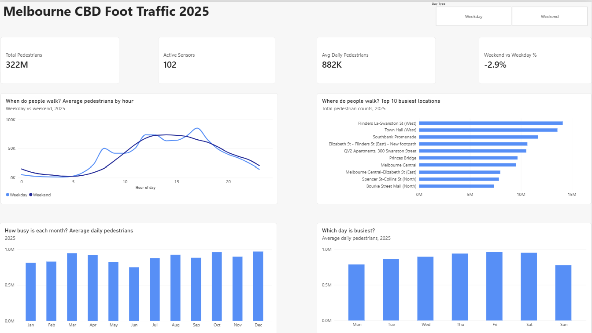

# Melbourne CBD Foot Traffic Dashboard

An interactive Power BI dashboard showing when and where people walk in Melbourne's CBD, built from a full year (2025) of City of Melbourne hourly pedestrian sensor data.



## Key findings
1. **Swanston Street is the city's walking spine.** 3 of the 5 busiest locations sit on Swanston Street. The busiest, Flinders Lane–Swanston St (West), counted 14.1 million pedestrians in 2025 - about 38,600 a day.
2. **Weekdays and weekends move differently.** Weekdays have three peaks: the 8am commute, lunch, and the 5pm commute (about 85,000 people an hour across all sensors - the busiest hour of the week). Weekends build to one wide peak around 1-2pm and stay busier than weekdays after 7pm. Overall, an average weekend day is only 2.9% quieter than a weekday, so the CBD is not just a commuter area.
3. **Foot traffic builds through the week.** Sunday and Monday are the quietest days, traffic climbs every day to Friday (the busiest), and Saturday is close behind. Across the year, June is the quietest month.

## Data
- **Source:** [City of Melbourne Open Data - Pedestrian Counting System (counts per hour)](https://data.melbourne.vic.gov.au/explore/dataset/pedestrian-counting-system-monthly-counts-per-hour/) and [Sensor Locations](https://data.melbourne.vic.gov.au/explore/dataset/pedestrian-counting-system-sensor-locations/)
- **Period:** 1 January - 31 December 2025
- **Size:** 815,447 hourly readings from 102 sensors, 322 million pedestrian counts in total
- One row = the number of people who walked past one sensor in one hour

## How it was built
1. **Download** - `scripts/download_data.py` pulls the data from the City of Melbourne API and checks it (row counts, missing values, join coverage)
2. **Clean (Power Query)** - removed unused columns, set data types, renamed fields, removed duplicate sensors
3. **Data quality fix** - two sensors (IDs 28 and 78), about 2% of rows and 6.1 million pedestrians, were missing from the City's sensor table. I kept them in city-wide totals and added them as "Unnamed sensor (ID 28/78)" rather than dropping the data
4. **Model** - star schema: an hourly `Counts` fact table linked to `Sensors` and a DAX `Date` table (month, weekday, weekend flag)
5. **DAX measures** - Total Pedestrians, Avg Daily Pedestrians (averaged per day so months of different lengths compare fairly), Active Sensors, Weekend vs Weekday %
6. **Visuals** - KPI cards, hourly line chart, top 10 locations, monthly and day-of-week trends, with a weekday/weekend slicer that filters the whole page

## Run it yourself
```bash
pip install -r requirements.txt
python scripts/download_data.py
```
Then open `dashboard/melbourne_pedestrians.pbix` in Power BI Desktop and click Refresh.

## Tech
Python (pandas, requests) · Power BI (Power Query, DAX, data modelling) · Git

## What I'd improve next
- Add Bureau of Meteorology weather data to measure how rain and temperature change foot traffic
- Add a map of sensor locations
- Compare 2025 with earlier years to track the CBD's recovery since 2020
